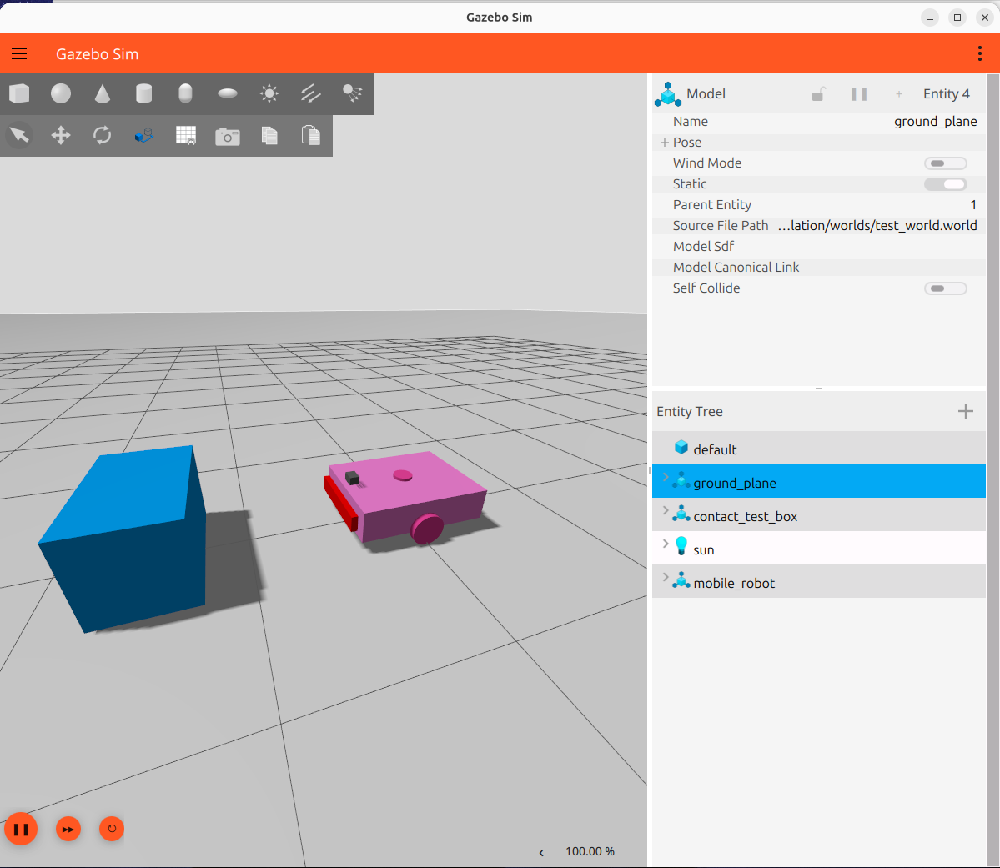
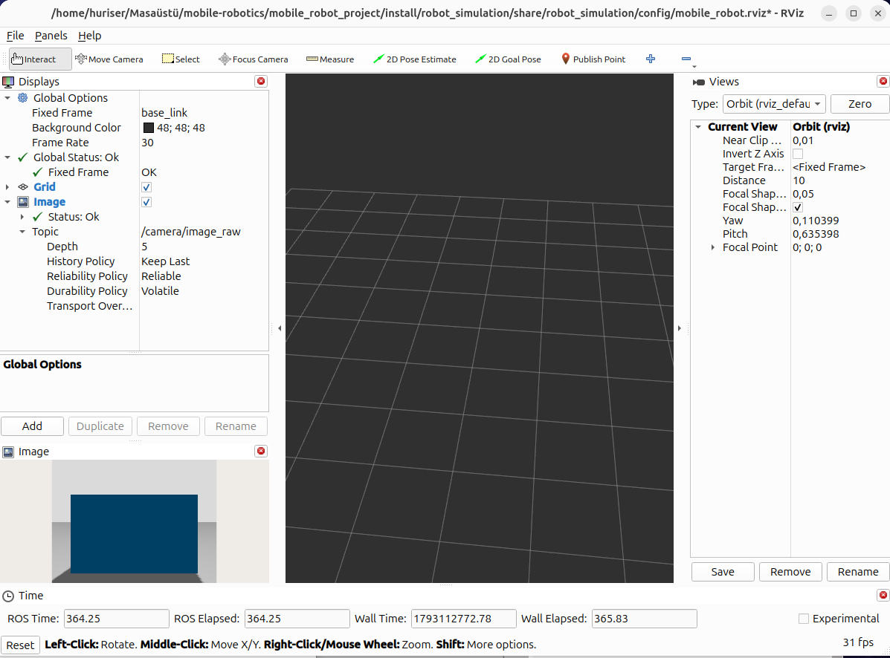

# Camera Sensor Test Report

## 1. Objective

The objective of this test is to verify that the camera sensor integrated into the mobile robot publishes image data correctly and that the images can be visualized in RViz 2.

## 2. Test Environment

- Operating System: Ubuntu 26.04
- ROS Distribution: ROS 2 Lyrical
- Simulator: Gazebo Jetty
- Camera Resolution: 640 × 480
- Configured Update Rate: 30 Hz
- Test Environment: Gazebo world containing a mobile robot and a static box obstacle.

## 3. Test Procedure

1. The mobile robot was launched in the Gazebo simulation environment.
2. The camera sensor was activated as part of the robot model.
3. The camera image topic was checked using ROS 2 command-line tools.
4. The camera image was visualized in RViz 2.
5. The camera publication frequency was measured using `ros2 topic hz /camera/image_raw`.

## 4. Results

| Parameter | Result |
|---|---|
| Image Topic | `/camera/image_raw` |
| Message Type | `sensor_msgs/msg/Image` |
| Publisher | `ros_gz_bridge` |
| Subscriber | `rviz2` |
| Publisher Count | 1 |
| Subscriber Count | 1 |
| Configured Frequency | 30 Hz |
| Measured Frequency | Approximately 30.3 Hz |

The camera successfully published image messages through the Gazebo–ROS 2 bridge. The image stream was received and displayed in RViz 2.

The measured publication frequency was approximately 30.3 Hz, which is consistent with the configured camera update rate.

## 5. Test Evidence

### Gazebo Simulation

### Camera Visualization in RViz 2

### Recorded Measurements

- [Camera Topic Information](camera_topic_info.txt)
- [Camera Frequency Measurements](camera_frequency.txt)

## 6. Conclusion

The camera sensor was successfully integrated into the mobile robot simulation. Image publishing, ROS 2 communication, and RViz 2 visualization were verified.

**Test Result: PASSED**