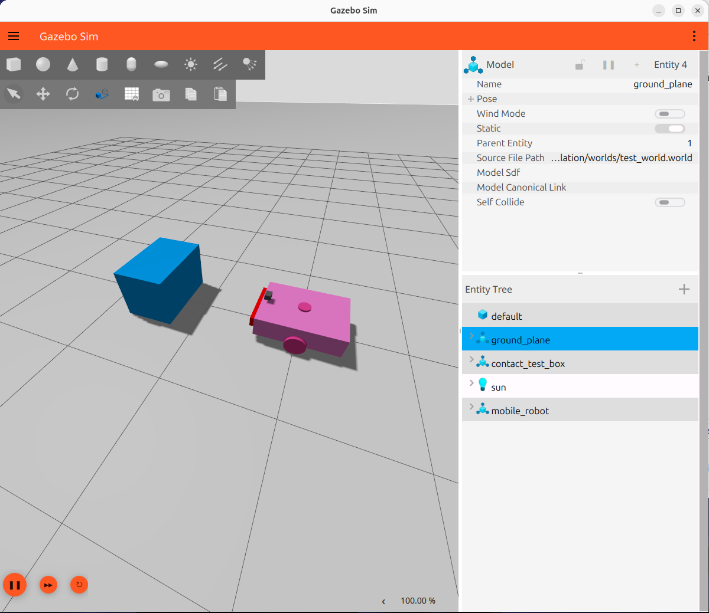
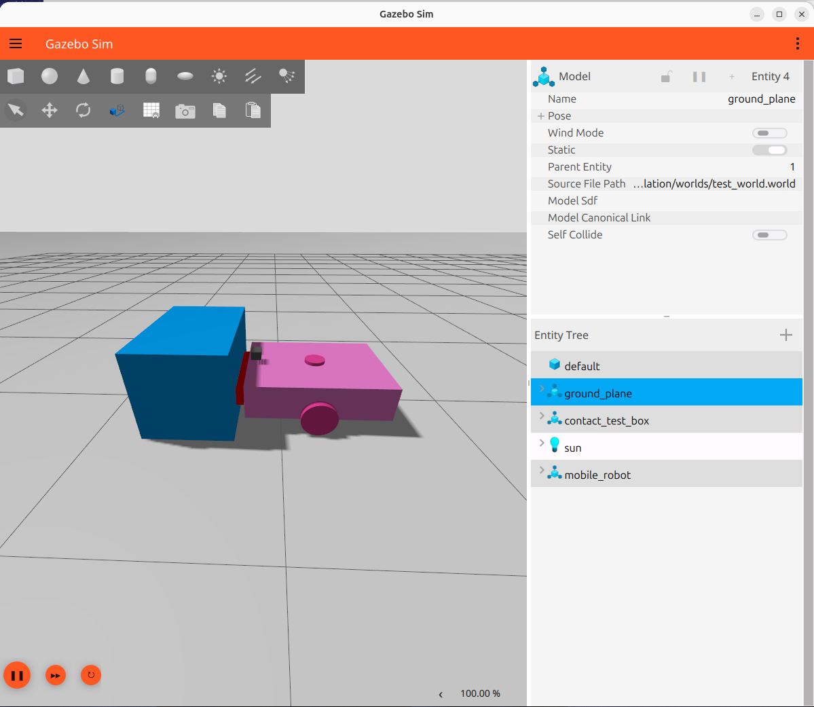

# Contact Sensor Test Report

## 1. Objective

The objective of this test is to verify that the contact sensor mounted on the mobile robot's front bumper detects collisions with an obstacle in the Gazebo simulation environment.

## 2. Test Environment

- Operating System: Ubuntu 26.04
- ROS Distribution: ROS 2 Lyrical
- Simulator: Gazebo Jetty
- Contact Sensor: Front bumper contact sensor
- Test Obstacle: `contact_test_box`
- ROS 2 Topic: `/contact`
- Message Type: `ros_gz_interfaces/msg/Contacts`

## 3. Test Procedure

1. The mobile robot and a static box obstacle were loaded into Gazebo.
2. The contact sensor data was monitored through the `/contact` ROS 2 topic.
3. A forward velocity command was published to move the robot toward the obstacle.
4. The robot's front bumper made contact with the box.
5. The collision information was recorded and examined.

## 4. Results

The contact sensor successfully detected a collision between the robot's front bumper and the test obstacle.

**Detected Robot Collision Geometry:**

```text
mobile_robot::front_bumper_link::front_bumper_link_fixed_joint_lump__front_bumper_collision_collision
```

**Detected Obstacle Collision Geometry:**

```text
contact_test_box::box_link::box_collision
```

The recorded contact message contained both collision geometries, confirming that the front bumper detected contact with the box.

The sensor also reported contact force information during the collision.

## 5. Test Evidence

### Before Collision



### After Collision



### Recorded Collision Data

- [Contact Topic Information](contact_topic_info.txt)
- [Collision Data Sample](contact_collision_sample.yaml)

## 6. Conclusion

The front bumper contact sensor successfully detected a collision with the static obstacle in Gazebo.

The collision data was transmitted to ROS 2 through the Gazebo–ROS 2 bridge and recorded for verification.

**Test Result: PASSED**