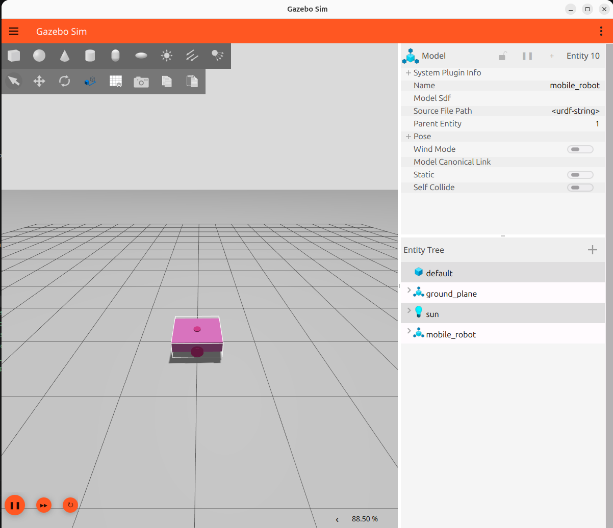
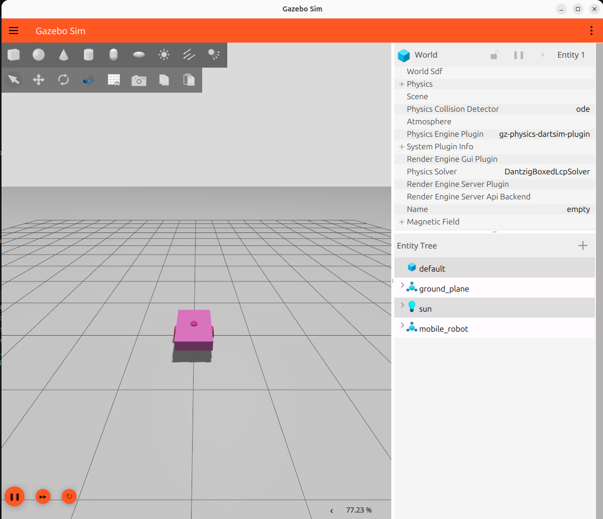
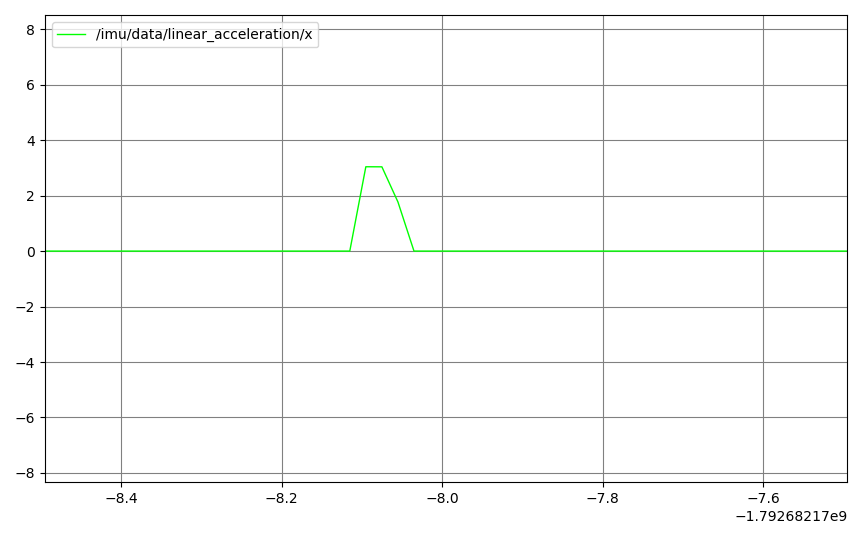
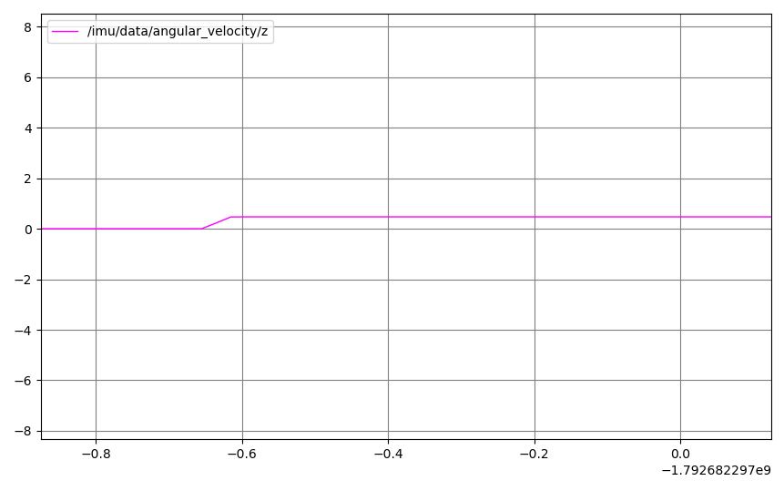
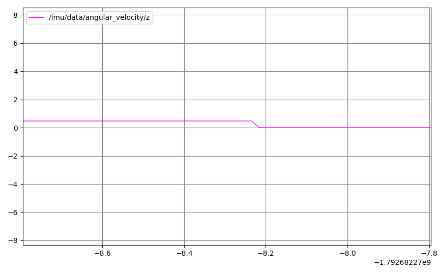
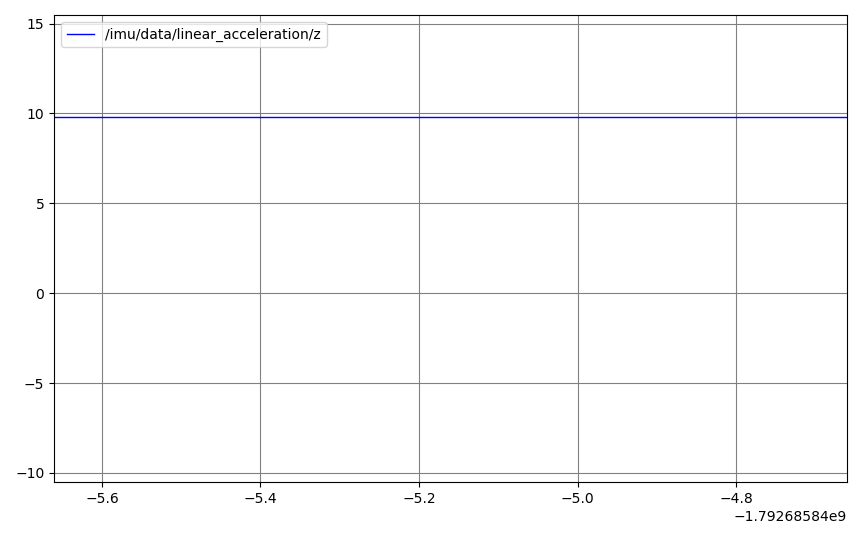

# Robot Hareket Sistemi ve IMU Test Sonuçları

## Test Ortamı
- Simülasyon: Gazebo Sim
- Robot kontrolü: ROS 2
- Hareket komutu: /cmd_vel
- IMU veri konusu: /imu/data

## Test 1 — Robotun Simülasyonda Görünmesi
Gözlem: Robot gövdesi, hareket tekerlekleri ve ön/arka destek tekerlekleri Gazebo'da görüntülendi.
Sonuç: Başarılı.

## Test 2 — Robotun İleri Hareketi
Komut: /cmd_vel üzerinden pozitif doğrusal hız gönderildi.
Gözlem: Robot ileri hareket etti.
Sonuç: Başarılı.

## Test 3 — Robotun Durdurulması
Komut: /cmd_vel üzerinden sıfır hız komutu gönderildi.
Gözlem: Robot durdu.
Sonuç: Başarılı.

## Test 4 — IMU Veri Yayını
Konu: /imu/data
Gözlem: Yönelim, açısal hız ve doğrusal ivme alanlarını içeren ölçümler alındı.
Sonuç: Başarılı.

## Test 5 — Dönüş Sırasında Açısal Hız
Gözlem: angular_velocity.z yaklaşık 0.4706 rad/s ölçüldü.
Sonuç: Gönderilen dönüş komutuyla uyumlu.

## Test 6 — Robot Dururken Açısal Hız
Gözlem: angular_velocity.z yaklaşık 0 rad/s ölçüldü.
Sonuç: Başarılı.

## Test 7 — Yerçekimi İvmesi
Gözlem: linear_acceleration.z yaklaşık 9.8 m/s^2 ölçüldü.
Sonuç: Beklenen yerçekimi değeriyle uyumlu.

