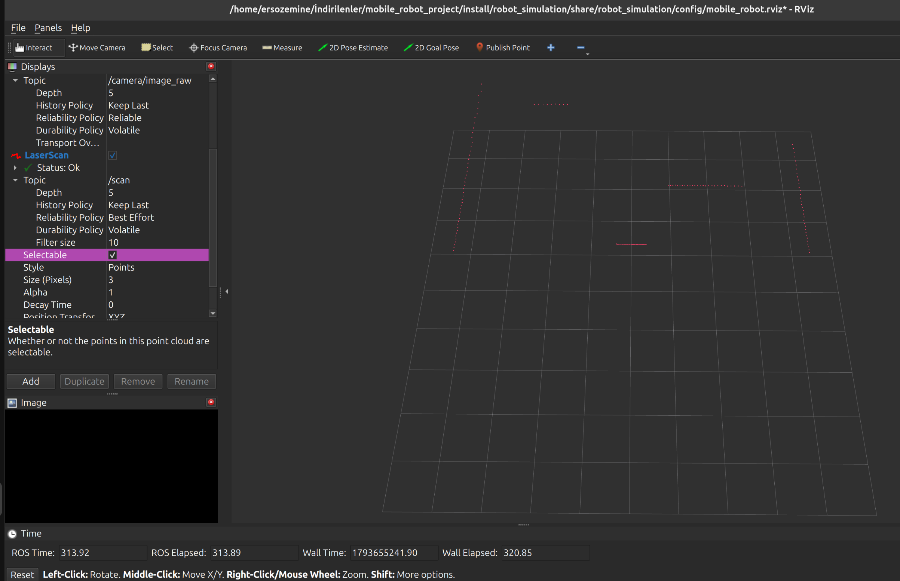
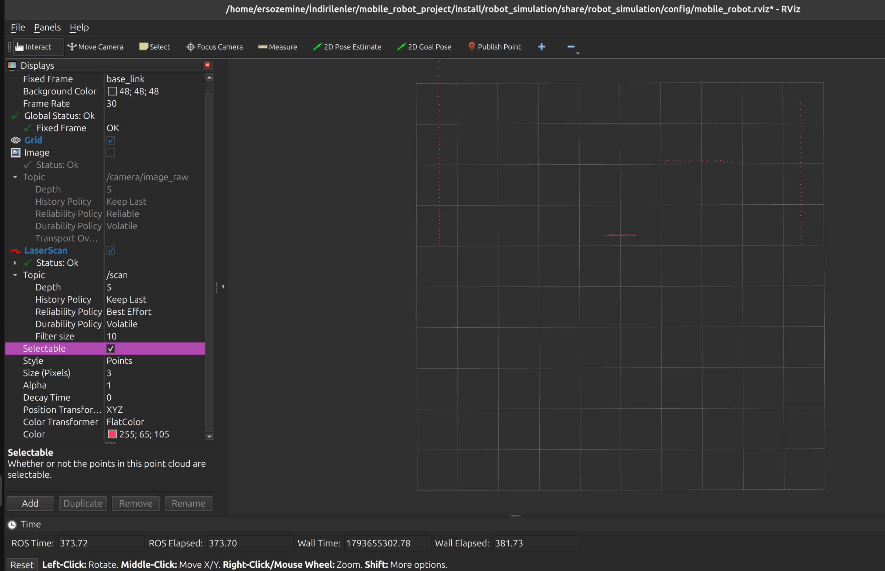
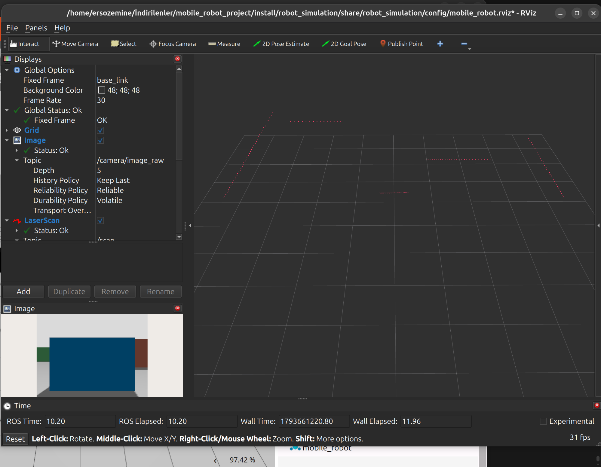

# LiDAR Test Record

## Test scope

Verify the simulated LiDAR configuration and ROS 2 bridge, and confirm that RViz displays live `/scan` LaserScan points.

## Configuration evidence

| Item | Configured value | Source |
|---|---|---|
| Sensor | Gazebo GPU LiDAR | [`lidar.xacro`](../../robot_description/urdf/lidar.xacro) |
| Scan topic | `/scan` | [`lidar.xacro`](../../robot_description/urdf/lidar.xacro) |
| Scan rate | 10 Hz | [`lidar.xacro`](../../robot_description/urdf/lidar.xacro) |
| Horizontal samples | 360 over 360 degrees | [`lidar.xacro`](../../robot_description/urdf/lidar.xacro) |
| Range | 0.12–8.0 m | [`lidar.xacro`](../../robot_description/urdf/lidar.xacro) |
| Gazebo to ROS bridge | `/scan` to `sensor_msgs/msg/LaserScan` | [`robot_simulation.launch.py`](../../robot_simulation/launch/robot_simulation.launch.py) |
| RViz display | LaserScan enabled on `/scan` | [`mobile_robot.rviz`](../../robot_simulation/config/mobile_robot.rviz) |
| Avoidance node | Subscribes to `/scan`; publishes `/cmd_vel` | [`obstacle_avoidance.py`](../../robot_behavior/robot_behavior/obstacle_avoidance.py) |

These values were checked in the project files. They establish the configured setup; they are not a live measurement of the running ROS graph.

## RViz visual evidence

The screenshots show the LaserScan display on `/scan`, with scan points visible and RViz reporting status OK.







Combined Gazebo and RViz views are stored directly in [`obstacle_world`](../obstacle_world/), including [00:39:26](../obstacle_world/gazebo_rviz_course_00-39-26.png) and [00:40:35](../obstacle_world/gazebo_rviz_course_00-40-35.png).

## Evidence status

| Evidence | Status |
|---|---|
| LiDAR, bridge, and RViz configuration in project files | Verified |
| RViz LaserScan points on `/scan` | Captured in screenshots above |
| `/scan` publisher and live message sample | Captured; publisher is `scan_bridge`, message type is `sensor_msgs/msg/LaserScan`, sample frame is `lidar_link` |
| Measured `/scan` frequency | Approximately 7.4 Hz in the captured GUI session; configured rate is 10 Hz |
| Full-course successful run | Tracked in [`obstacle_avoidance_test.md`](../obstacle_world/obstacle_avoidance_test.md) |

Runtime artifacts:

The recorded files make the ROS publisher, live scan data, measured publication rate and controller output reviewable:

- [`scan_topic_info.txt`](scan_topic_info.txt): publisher and message type for `/scan`.
- [`scan_sample.txt`](scan_sample.txt): one live `LaserScan` message in the `lidar_link` frame.
- [`scan_frequency.txt`](scan_frequency.txt): measured `/scan` publication rate; the latest readings are around 7.4 Hz, below the configured 10 Hz.
- [`obstacle_avoidance_run.log`](../obstacle_world/obstacle_avoidance_run.log): motion-mode and velocity logs from the GUI course run.
- [Course completion screenshot with terminal telemetry](../obstacle_world/course_completion_terminal_20261103.png).

## Repeat the capture

Keep Gazebo and RViz running from the GUI launch. In a separate sourced terminal, save topic details and a sample:

```bash
cd /home/ersozemine/İndirilenler/mobile_robot_project
source /opt/ros/lyrical/setup.bash
source install/setup.bash
mkdir -p test_results/lidar
ros2 topic info /scan --verbose | tee test_results/lidar/scan_topic_info.txt
ros2 topic echo /scan --once > test_results/lidar/scan_sample.txt
```

Measure the scan rate in another terminal; stop it with Ctrl+C after the readings stabilize:

```bash
cd /home/ersozemine/İndirilenler/mobile_robot_project
source /opt/ros/lyrical/setup.bash
source install/setup.bash
ros2 topic hz /scan --window 20 | tee test_results/lidar/scan_frequency.txt
```

Run the avoidance node with its terminal output saved while completing the course in the GUI:

```bash
cd /home/ersozemine/İndirilenler/mobile_robot_project
source /opt/ros/lyrical/setup.bash
source install/setup.bash
ros2 run robot_behavior obstacle_avoidance 2>&1 | tee test_results/obstacle_world/obstacle_avoidance_run.log
```
