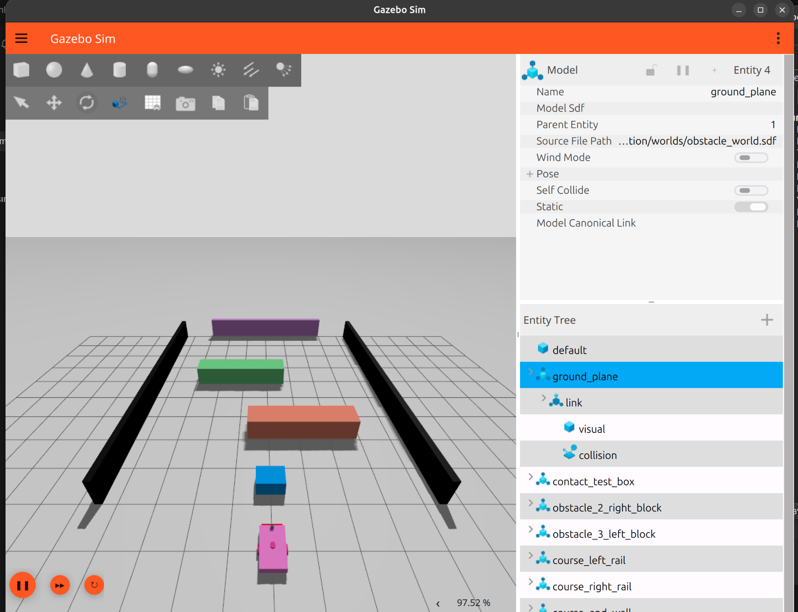
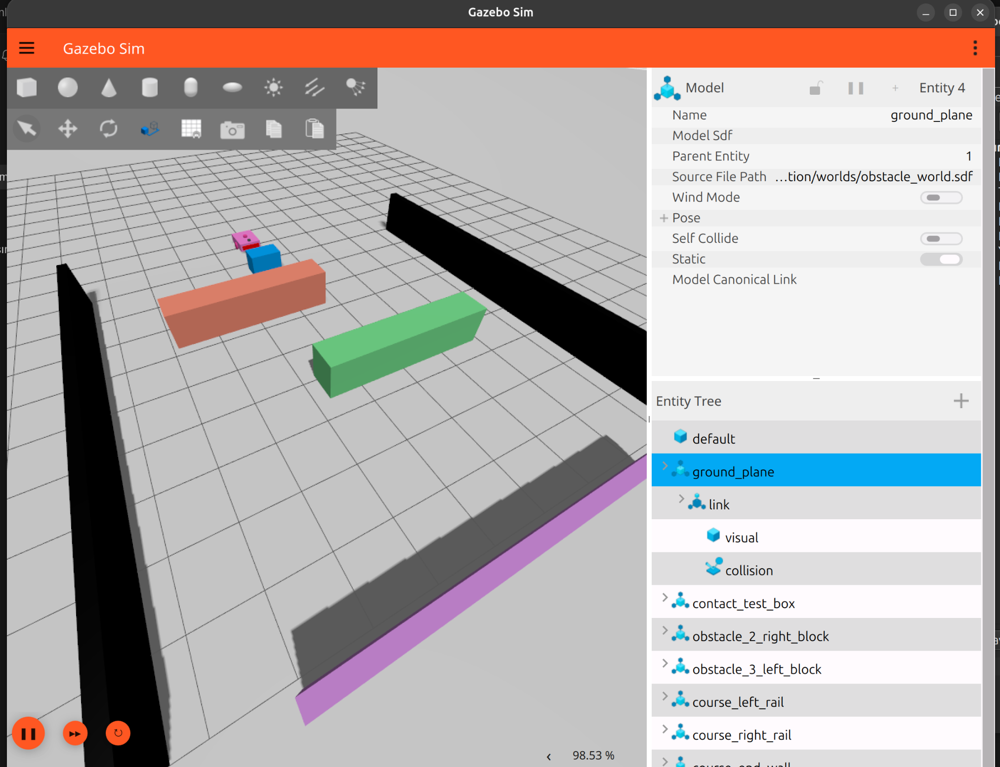
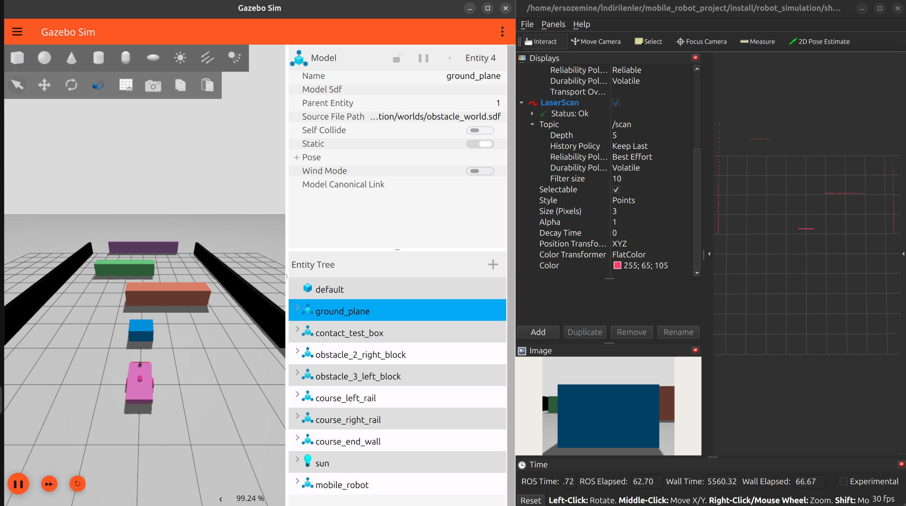
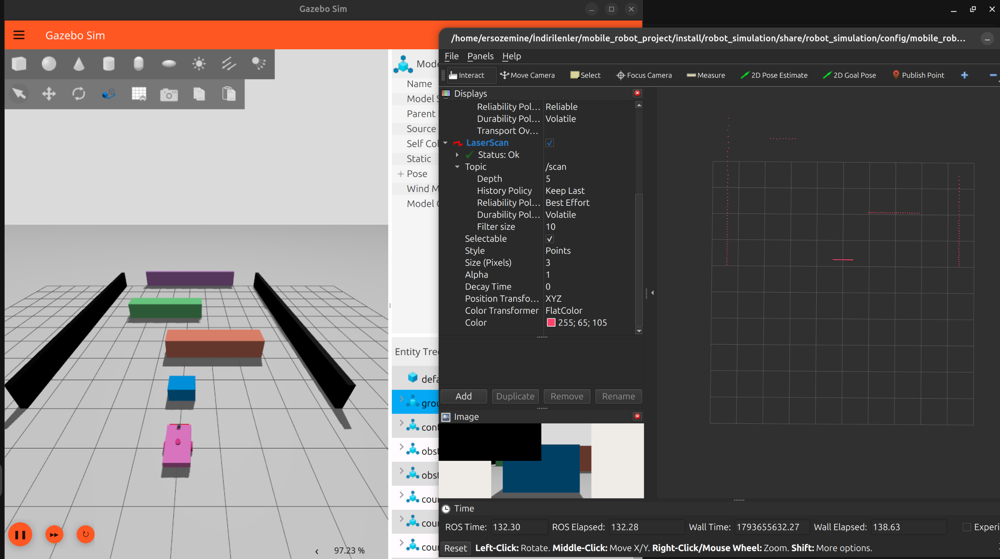
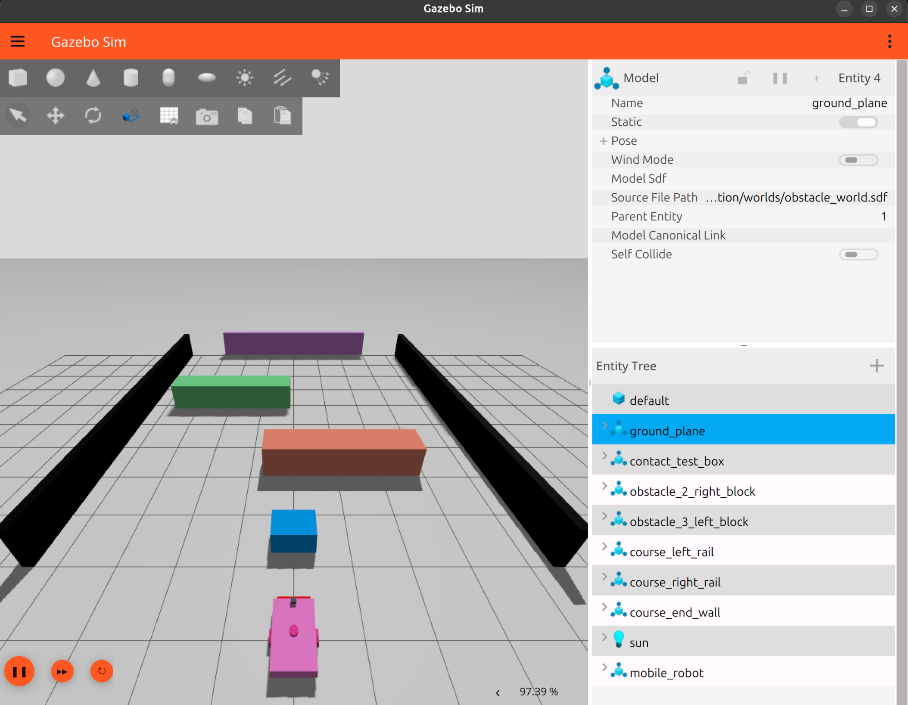
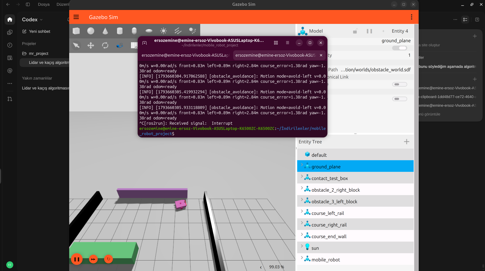
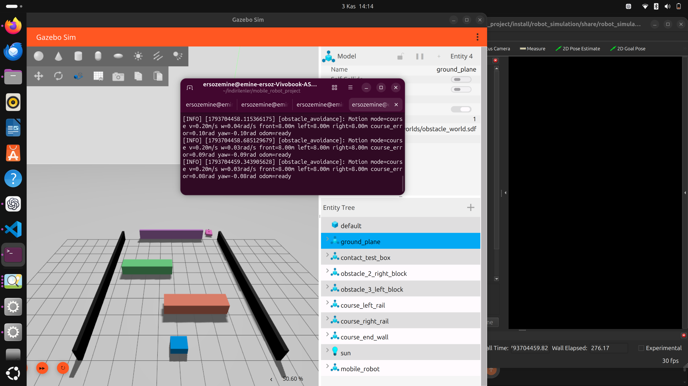

# Obstacle World and Avoidance Test Record

## Test setup

- Simulator: Gazebo GUI with RViz open.
- World: `robot_simulation/worlds/obstacle_world.sdf`.
- Controller: `ros2 run robot_behavior obstacle_avoidance`.
- Course direction: world `+X` (`course_heading = 0.0 rad`).
- Topics: `/scan` (`LaserScan`), `/odom` (`Odometry`) and `/cmd_vel` (`Twist`).

The course contains a blue starting obstacle, orange and green barriers, side rails and an end wall. The green barrier is positioned at `x=6.2 m, y=1.9 m`; the side rails are centered at `y=±4.5 m`.

## Current controller behavior

| Setting | Current value |
| --- | ---: |
| Obstacle trigger distance | `0.90 m` |
| Clear distance to leave avoidance | `1.20 m` |
| Forward speed | `0.20 m/s` |
| Turn speed | `0.55 rad/s` |
| Front scan half-angle | `0.80 rad` |
| Maximum course deviation | `π/2 rad` (90°) |
| Scan timeout | `0.5 s` |

The controller chooses the side with greater LiDAR clearance when an obstacle enters the trigger distance, then holds that turn direction while avoiding it. It returns to course motion after the front sector reaches the clear distance. It can switch to the opposite side once if the selected side becomes blocked (`≤0.90 m`) and the other side has at least `1.20 m` clearance. During course motion it steers back toward `+X` using odometry.

The node publishes zero velocity if odometry is not available, scan metadata or usable front returns are invalid, or the scan stream times out. At the course-deviation limit during avoidance, it creeps forward at `0.08 m/s` if the front distance is above `0.90 m`; otherwise it stops. The terminal reports motion mode, linear and angular velocity, front/left/right scan distances, course error, yaw and odometry readiness on mode changes and at 0.5-second intervals.

## Evidence and result

The following screenshots show the course from multiple Gazebo views and the simulator with RViz:











The combined Gazebo and terminal screenshot records the robot at the final obstacle alongside LiDAR and motion telemetry:



**GUI course result: PASSED (operator-reported on 2026-11-03).** The operator confirmed that the robot completed the course. LiDAR visualization evidence is listed in [`../lidar/lidar_test.md`](../lidar/lidar_test.md).

### Completed run evidence



The associated terminal output is saved in [`obstacle_avoidance_run.log`](obstacle_avoidance_run.log). It records the controller's course, avoidance and heading-recovery modes, commanded velocities, LiDAR sector distances and odometry state. The measured `/scan` rate and live sample are recorded in [`../lidar/lidar_test.md`](../lidar/lidar_test.md).

The controller log does not include a separate measured course-duration value.

## Save a future run log

With Gazebo and RViz running, start the controller and save its terminal output:

```bash
cd /home/ersozemine/İndirilenler/mobile_robot_project
source /opt/ros/lyrical/setup.bash
source install/setup.bash
ros2 run robot_behavior obstacle_avoidance 2>&1 | tee test_results/obstacle_world/obstacle_avoidance_run.log
```
